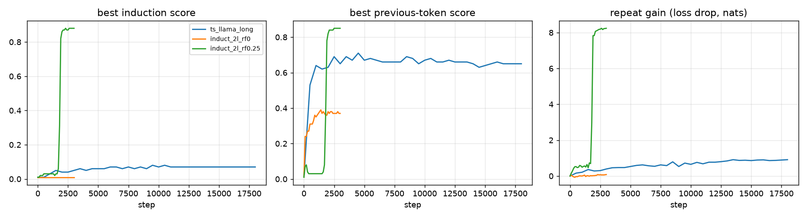
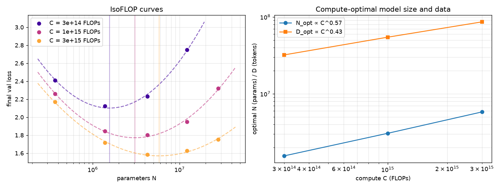

A GPT-style language model built from scratch: BPE tokenizer, transformer (GPT-2 and Llama-style variants), training loop, KV-cached sampling, and a GPT-2 weight-loading parity check. A 12M-parameter model trained for ~10 minutes on one RTX 5060 writes coherent children's stories.

## Project structure
```text
pocket-gpt/
├── bpe.py               # Byte-level BPE from scratch: GPT-4 regex pre-split, incremental merge training, special tokens
├── data.py              # Download corpus (Tiny Shakespeare / TinyStories), tokenize -> data/<name>/, random-window batches
├── model.py             # Decoder-only transformer: GPT-2 defaults, flags for RoPE / RMSNorm / SwiGLU / no-bias,
│                        #   hand-written or SDPA (Flash) attention, KV cache, temperature / top-k / top-p sampling
├── train.py             # AdamW param groups + warmup/cosine, grad clipping, bf16, torch.compile, eval (loss + bits/byte), checkpoint/resume
├── sample.py            # Generate text from a checkpoint with its own tokenizer (KV cache on by default)
├── gpt2.py              # Load OpenAI GPT-2 (124M) weights from Hugging Face into model.GPT
├── scaling.py           # Scaling sweep: 5 model sizes, same token budget, power-law fit L(N) = c + a·N^-alpha
├── isoflop.py           # Compute-optimal (Chinchilla IsoFLOP) sweep: 3 budgets x 5 sizes, optimal N and D vs compute
├── analysis.py          # Attention maps, induction / previous-token heads (also over training), embeddings + PCA
├── finetune.py          # SFT on TinyStories-Instruct: plain-text or chat format (<|user|>/<|assistant|> tokens)
├── chat.py              # Talk to a chat-tuned model in the terminal
├── tests/
│   ├── test_model.py    # per config (GPT-2/Llama x manual/SDPA): initial loss, no future leak, overfit one batch,
│   │                    #   manual == SDPA attention, KV cache == full forward, cached == uncached generation, top-p
│   ├── test_bpe.py      # first merge, unicode round-trip, compression, reload, incremental == naive training, specials
│   ├── test_finetune.py # instruct parsing, response-only loss mask, chat requests name every word, grow_vocab
│   └── test_gpt2_parity.py  # our logits == Hugging Face GPT-2 logits (skipped without transformers)
├── assets/banners/      # README banners (PNG) + their HTML sources
├── assets/analysis/     # plots written by scaling.py and analysis.py
├── requirements.txt     # torch, numpy, regex, pytest (+ transformers, matplotlib, optional)
│
├── data/                # generated, git-ignored
│   ├── input.txt, tinystories_*.txt   # raw corpora
│   └── <name>/          #   train.bin, val.bin (uint16 token ids), meta.json (vocab/merges + byte counts)
└── runs/                # generated, git-ignored
    └── <run>/ckpt.pt    #   model, optimizer, step, RNG, config, args (saved every eval)
```

**Data flow:** raw text → `data.py` (tokenizer) → `train.bin`/`val.bin` → `train.py` (batches → `model.py` → cross-entropy → AdamW) → `ckpt.pt` → `sample.py` → text

## Quickstart
```bash
python -m venv .venv && .venv/bin/pip install -r requirements.txt
.venv/bin/python -m pytest -q tests      # sanity checks (GPT-2 parity downloads 548 MB on first run)

# TinyStories, 12M params (~400 MB of text -> 98M tokens; ~1 min to prepare)
.venv/bin/python data.py --dataset tinystories --tokenizer bpe --vocab_size 4096
.venv/bin/python train.py --data data/tinystories_bpe4096 --out runs/ts_llama \
    --n_layer 6 --n_head 6 --n_embd 384 --block_size 256 --steps 6000 --warmup 200 --eval_interval 500 --compile \
    --bias false --norm rmsnorm --mlp swiglu --pos rope          # drop this line for GPT-2 style
.venv/bin/python sample.py --ckpt runs/ts_llama/ckpt.pt --prompt "Once upon a time" --temperature 0.8 --top_p 0.9

# Tiny Shakespeare, character-level (~1 min)
.venv/bin/python data.py
.venv/bin/python train.py
.venv/bin/python sample.py --prompt "ROMEO:"

# Real GPT-2 weights running in this codebase
.venv/bin/python gpt2.py "Hello, I'm a language model,"

# Experiments (need the TinyStories data above)
.venv/bin/python scaling.py                                      # 5 sizes, ~15 min, resumable -> assets/analysis/scaling.png
.venv/bin/python analysis.py --ckpt runs/ts_llama/ckpt.pt        # attention / induction / embedding plots
.venv/bin/python finetune.py --base runs/ts_llama/ckpt.pt        # instruction SFT + base-vs-SFT eval, ~5 min

# Full TinyStories (2.2 GB -> 546M tokens, ~35 s on 16 cores, streamed so memory stays flat)
.venv/bin/python data.py --dataset tinystories --tokenizer bpe --vocab_size 4096 --train_mb 2300
.venv/bin/python isoflop.py                                      # compute-optimal sweep, ~30 min -> isoflop.png
.venv/bin/python train.py --data data/tinystories_bpe4096_2300mb --out runs/ts_llama_long --steps 18000 \
    --n_layer 6 --n_head 6 --n_embd 384 --block_size 256 --warmup 200 --eval_interval 500 --compile --induction \
    --bias false --norm rmsnorm --mlp swiglu --pos rope          # 295M tokens, ~17 min, logs induction scores
.venv/bin/python finetune.py --base runs/ts_llama_long/ckpt.pt --out runs/ts_llama_long_chat --chat
.venv/bin/python chat.py --ckpt runs/ts_llama_long_chat/ckpt.pt
```
Every model field is a flag (`train.py --help`). A checkpoint is saved at every eval; continue a stopped run with
`train.py --out <same dir> --resume` (keep the same `--steps` so the LR schedule matches). Training refuses to overwrite an existing run without `--resume`.

## Results (RTX 5060, bf16)
Compare across tokenizers by **val bits per byte (bpb)**: loss is per token, and tokens differ in size.

**TinyStories, 12M params, 6000 steps x 16k tokens (98M tokens, 1 epoch), identical settings:**

| Architecture | Val loss | Val bpb | Throughput | Wall time |
|---|---|---|---|---|
| GPT-2 style (learned pos, LayerNorm, GELU) | 1.512 | 0.543 | 256k tok/s | ~6.5 min |
| Llama style (RoPE, RMSNorm, SwiGLU, no bias) | **1.480** | **0.532** | 171k tok/s | ~9.7 min |

Llama style is better at every step (it reached GPT-2's final 0.543 at step 5000). Those runs were eager mode, where
Llama style is ~33% slower because RoPE and RMSNorm run as separate unfused ops. Train/val stay within 0.03: no overfitting.

**`torch.compile`** (`--compile`, same 12M models, 600-step benchmark; loss unchanged):

| | Eager | Compiled | Speedup |
|---|---|---|---|
| GPT-2 style | 252k tok/s | 295k tok/s | 1.17x |
| Llama style | 169k tok/s | 290k tok/s | **1.71x** |

Compilation fuses the elementwise RoPE/RMSNorm/SwiGLU ops, which closes almost the whole gap. It costs ~20 s of warmup, so skip it for short debug runs.

> Once upon a time, there was a little girl named Lily. She had a big, soft teddy bear that she loved very much. One day, she went to the park to play with her teddy bear. While playing, Lily saw a little boy who was sad. He had lost his teddy bear. Lily wanted to help [...] The moral of the story is that when we help others, we make new friends and make them happy.
>
> — Llama-style 12M, temperature 0.8, top-p 0.9

**GPT-2 parity:** with OpenAI's 124M weights loaded, logits match Hugging Face's within 1e-3, and greedy decoding gives GPT-2's known output.

**KV cache:** GPT-2 124M generating 600 tokens: 445 vs 82 tok/s (5.4x). For the 12M model with a 256-token context there is
almost nothing to save (~375 vs ~405 tok/s on GPU): per-token time is kernel-launch overhead, not compute.

**Tiny Shakespeare, 0.8M params:**

| Tokenizer | Bytes/token | Best val bpb |
|---|---|---|
| char (65) | 1.00 | 2.21 (~step 4000) |
| BPE 1024 | 2.62 | 2.22 (~step 1000), then overfits hard (383k train tokens) |

- Warmup + cosine + clipping vs constant LR: val loss 1.54 at ~3000 steps vs 1.56 at ~4250.
- bf16 vs fp32: ~1.20M vs ~0.73M tok/s, same loss.

## Scaling sweep
`python scaling.py` trains five Llama-style models on the same 49M TinyStories tokens (3000 steps, identical
hyperparameters, `--compile`, ~15 min total) and fits loss against non-embedding parameters N:

| Model | Shape (layers, heads, dim) | Non-emb params | Val loss | Val bpb |
|---|---|---|---|---|
| xs | 2, 2, 64 | 0.11M | 2.658 | 0.955 |
| s | 4, 4, 128 | 0.85M | 2.045 | 0.735 |
| m | 4, 4, 256 | 3.21M | 1.728 | 0.621 |
| l | 6, 6, 384 | 10.6M | 1.600 | 0.575 |
| xl | 8, 8, 512 | 25.7M | 1.516 | 0.545 |

**Fit: L(N) = 1.19 + 36.1 · N^-0.28.** Every 10x in parameters buys less than the last, and loss flattens toward an
irreducible ~1.19 for this data budget. The larger models are still improving at 49M tokens, so they are data-limited here.


## Inside the model
`python analysis.py --ckpt runs/ts_llama/ckpt.pt` (12M Llama-style model):

**Embeddings** learn meaning with no supervision. Nearest neighbours by cosine similarity:

| Token | Nearest neighbours |
|---|---|
| happy | glad, grateful, cheerful, proud, excited, sad |
| dog | cat, dogs, puppy, horse, bird, squirrel |
| red | yellow, blue, green, pink, black, purple |
| mom | mommy, dad, Mom, mother, mum, grandma |
| big | small, large, huge, little, pretty, long |


**Attention:** every head of every layer on a story prompt (row = query token, column = key token). Layer 3 head 4 is a
clean *previous-token head* (one step off the diagonal).


**Induction heads** (attend to the token after the previous occurrence of the current token, so a repeated sequence can
be copied) are tested on a random 50-token sequence repeated twice. Across the sweep, previous-token heads strengthen
with size (best score 0.32 → 0.68), but induction scores stay small (0.01 → 0.06) and the repeat gets only modestly
easier (loss −0.65 at 25.7M).

**Do they form with more training?** `train.py --induction` logs the scores at every eval:

| Run | Data | Steps | Best induction score | Repeat gain (nats) |
|---|---|---|---|---|
| 12M Llama-style, long run | TinyStories, 295M tokens | 18000 | 0.07 | 0.91 |
| 2-layer control | TinyStories | 3000 | 0.01 | 0.08 |
| 2-layer + repeats (`--repeat_frac 0.25`) | TinyStories + 25% random sequences repeated with a random period | 3000 | **0.88** | **8.24** |



On plain TinyStories, 3x more training only nudges them (repeat gain 0.65 → 0.91; induction score stays ~0.07): the data
rarely rewards copying arbitrary sequences. When 25% of each batch is random tokens repeated with a random period, the
same 2-layer model shows the classic **phase change**: nothing for ~1700 steps, then within ~300 steps a previous-token
head (0.03 → 0.85) and an induction head (0.03 → 0.88) appear together and repeated sequences become almost free to
predict (loss −8.2 nats). The circuit needs both halves, so neither helps alone and they form at once.

A first version of this control used a fixed repeat period (129 tokens) and showed nothing: with RoPE the model solved it
with a positional "look exactly 128 back" head that does not transfer to other periods. A random period per row forces
the content-based mechanism.

## Compute-optimal sweep (Chinchilla)
`python isoflop.py`: for each compute budget C, every size N trains for exactly D = C/(6N) tokens with its cosine
schedule matched to that length (14 runs on the full 546M-token TinyStories, ~30 min). A parabola in log N per budget
gives the loss-minimising size.

| Budget (FLOPs) | Optimal params N | Optimal tokens D | Tokens / param |
|---|---|---|---|
| 3e14 | 1.6M | 32M | 21 |
| 1e15 | 3.1M | 54M | 18 |
| 3e15 | 5.8M | 86M | 15 |

**N_opt ∝ C^0.57, D_opt ∝ C^0.43**, and ~15–21 tokens per parameter: the Chinchilla result (≈0.5 / 0.5, ≈20 tokens per
parameter) reproduced at 1/10^8 of its scale. By this measure the 12M models above, trained on 98M tokens (8 tokens/param),
were undertrained for their size, which the long run confirms (val loss 1.480 → 1.337 with 295M tokens).
Three budgets give a rough exponent; more budgets would tighten it.



## Instruction fine-tuning
`python finetune.py --base runs/ts_llama/ckpt.pt` fine-tunes the 12M model on TinyStories-Instruct: a prompt of
constraints (required words, features like Dialogue/BadEnding, a summary, a sentence to include) followed by the story.
The loss covers only the story tokens. 3000 steps x 32 examples (61k examples that fit in 256 tokens), ~2 min.

| Model | Story val loss | Required words used (100 held-out prompts) |
|---|---|---|
| base (pretrained only) | 1.80 | 15% |
| fine-tuned | **1.42** | **51%** |

The base model has never seen the prompt format and mostly continues it as text. The fine-tuned model writes a story
and uses about half the required words. It follows features and summaries only loosely: at 12M parameters, that is
about as far as instruction-following goes. Same held-out prompt, both models:

```text
Words: decide, hero, charming
Features: BadEnding
Summary: Timmy meets a charming hero during a walk, but the hero turns out to be a bad person [...]
Story:
```
> **base:** Store: Deal: Deal. Deal. Deal?" The hero nodded and said: "Deal.. I'm sorry. I didn't mean to take your toy. [...]
>
> **fine-tuned:** Timmy's friends wanted to play with him, but they didn't want to play with him. Timmy felt sad and started to cry. [...] Suddenly, the hero came out and said, "I'm sorry for your friend. I didn't mean to scare you. Let's go away and be friends." Timmy and his friends were happy again and they all went home to play together. The end.

The fine-tuned model writes a proper story with the hero in it, but misses "decide" and "charming" and ignores the bad ending.

**Better pretraining, better fine-tune.** The same plain SFT on the long-run model (295M tokens instead of 98M) reaches
story val loss 1.28 (vs 1.42) and uses **59%** of required words (vs 51%).

## Chat fine-tuning
`finetune.py --chat` adds two special tokens, `<|user|>` and `<|assistant|>`: the embedding table (and the tied output
head) grows from 4096 to 4098 rows, the new rows starting at the mean embedding so existing logits are unchanged. Each
example's constraints become a natural request with varied phrasing; the loss covers only the assistant's story:

```text
<|user|>Tell me a story. It should be about this: [summary] Use the words "tremble", "friend" and "cold". Use some foreshadowing.<|assistant|>[story]<|endoftext|>
```

`chat.py` encodes the user's text with `encode_ordinary`, so typing `<|assistant|>` can never forge a role token.

```text
you> Tell me a story about a little dragon who is afraid of the dark.
model> Once upon a time there was a little dragon who was very frightened. He was scared of the dark [...] One day, the
dragon decided to be brave. [...] Finally, they found a small cave. The dragon crawled inside and was no longer frightened.

you> Write a short story for kids. Use the words "moon", "boat" and "brave". Include some dialogue.
model> Once upon a time there was a sailor who loved to go sailing. Every morning the sailor would get out his boat [...]
he remembered his boat and how he was brave enough to stay in the boat.
```

| Format (on the long-run model) | Story val loss | Required words used |
|---|---|---|
| plain `Words: ... Story:` | 1.28 | 59% |
| chat request | 1.38 | 37% |

The chat model handles free-form requests (topic, lesson, sad ending) that the plain format cannot express, but follows
word constraints less reliably: the words are buried in a sentence instead of a dedicated field, the summary is dropped
from 30% of requests, and the two role tokens start untrained. In the dragon story it kept the topic; in the second it
used "boat" and "brave" but missed "moon" and the dialogue.

## Next
Multi-turn chat (needs a longer context) → longer pretraining of a compute-optimal 5–25M model → DPO / preference tuning.
