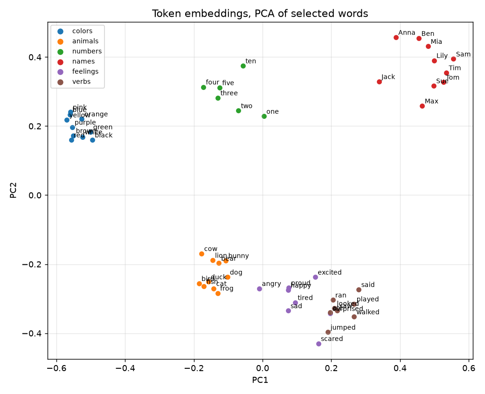
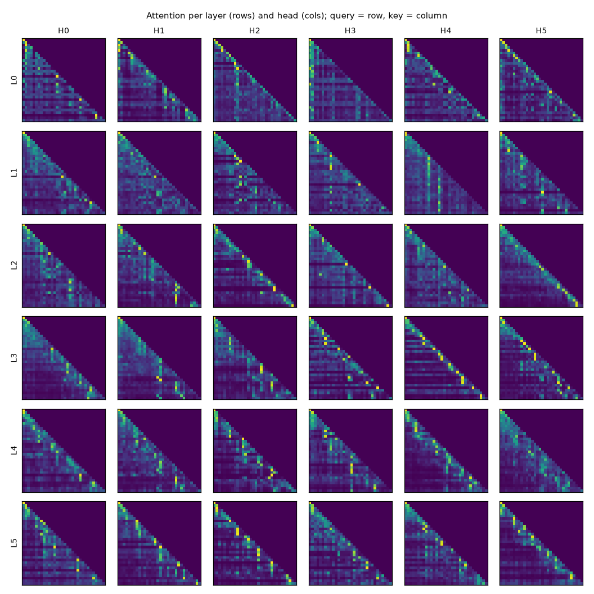

A GPT-style language model built from scratch: BPE tokenizer, transformer (GPT-2 and Llama-style variants), training loop, KV-cached sampling, and a GPT-2 weight-loading parity check. Models trained here, all on one RTX 5060:

| Model | Parameters | Context | Training | What it is |
|---|---|---|---|---|
| `ts_llama` | 12.2M | 256 | ~10 min | the first TinyStories model; already writes coherent stories |
| `ts_xl_1024` | 27.8M | 1024 | ~45 min | longer context; base for the first chat, judge and DPO models |
| `ts_42m_1024` | 42.2M | 1024 | ~100 min | base for the chat models (`ts_42m_dpo2`, `ts_42m_dpo3`) |
| `ts_62m_1024` | 62.1M | 1024 | ~3 h | the largest; base for `ts_62m_dpo` (val loss 1.068) |

## The model at a glance
The largest model here, **pocket-gpt 62M** (`ts_62m_dpo`), is a small chat model that tells children's stories.

**Type.** A decoder-only transformer language model (the GPT family) with Llama-style parts: rotary position
embeddings (RoPE), RMSNorm, a SwiGLU feed-forward, no bias terms, and an output layer tied to the token embedding.
It was pretrained from random weights, then fine-tuned for chat.

**Parameters.**

| | |
|---|---|
| Total parameters | **62.1M** (59.5M in the transformer blocks + 2.6M token embedding) |
| Layers | 12 |
| Attention heads | 10 (64 dims each) |
| Hidden size | 640 (SwiGLU inner size 1728) |
| Context length | 1024 tokens (~4 KB of text) |
| Vocabulary | 4,098: byte-level BPE with 4,096 tokens, plus `<\|user\|>` and `<\|assistant\|>` |
| Checkpoint size | 248 MB (float32 weights; the pretraining checkpoint is 745 MB because it also stores the optimizer state) |

**Training.** Three stages, ~4.5 hours in total on one RTX 5060 (8 GB):
1. **Pretraining** on 645M tokens of [TinyStories](https://huggingface.co/datasets/roneneldan/TinyStories)
   (1.18 passes, compute-optimal for this budget). Validation loss 1.068 (0.384 bits per byte).
2. **Multi-turn chat fine-tuning** on conversations built from TinyStories-Instruct: story requests, follow-up
   questions, greetings and off-topic messages.
3. **Preference tuning (DPO)**, 3 rounds on story requests and multi-turn conversation turns, rewarded by a learned
   judge that reads the whole conversation, with a KL penalty (weight 4) that keeps it close to the chat model.

**What it can do.**

Measured on `ts_62m_dpo`, with unseen phrasings for the chat rows:

| Ability | Result on held-out tests |
|---|---|
| Write a coherent children's story from a request | yes, ~180-190 tokens, simple English |
| Include required words ("use the words moon and boat") | 55% of words (50% before DPO) |
| Include dialogue when asked | 94% |
| Remember a character's name later in the chat | 100% |
| Recall which words you asked for, in a 2-story chat | 94-96% |
| Turn down gibberish / off-topic messages | 100% / 99% |
| Start a new story for a plain "story please" | 78% |
| Reply to a greeting | 55% as the first message, 68% mid-chat ("hi", "hello", "howdy" work) |

**What it cannot do.** It only knows the world of TinyStories: no general knowledge, maths, code or facts. It can't
answer questions about a story beyond names, the summary and the requested words. Plots sometimes lose logic
("she opened the trunk" of a tree), and anything older than 1024 tokens in the chat is forgotten.

**Which checkpoint to use.**

| Checkpoint | Use it for |
|---|---|
| `runs/ts_62m_dpo` | chatting and stories: the best all-round model |
| `runs/ts_42m_dpo3` | greetings: 81% of unseen first-message greetings, 100% off-topic; smaller and less precise on stories (47% of words) |
| `runs/ts_42m_dpo2` | the best 42M story model (54% of words); weaker on off-topic messages (83%) |
| `runs/ts_62m_chat` / `ts_42m_chat4` | the chat models before DPO |
| `runs/ts_62m_1024` | plain text continuation: the pretrained base, no chat format |
| `runs/ts_xl_chat3` | the earlier 28M chat model |

```bash
.venv/bin/python chat.py --ckpt runs/ts_62m_dpo/ckpt.pt
```

## Project structure
```text
pocket-gpt/
├── bpe.py               # Byte-level BPE from scratch: GPT-4 regex pre-split, incremental merge training, special tokens
├── data.py              # Download corpus (Tiny Shakespeare / TinyStories), tokenize -> data/<name>/, random-window batches,
│                        #   --add_v1: extend with TinyStories V1 stories not already in V2 (hash dedupe)
├── model.py             # Decoder-only transformer: GPT-2 defaults, flags for RoPE / RMSNorm / SwiGLU / no-bias,
│                        #   hand-written or SDPA (Flash) attention, KV cache, temperature / top-k / top-p sampling,
│                        #   left-padded batched generation (padding mask carried in the KV cache)
├── train.py             # AdamW param groups + warmup/cosine, grad clipping, grad accumulation, bf16, torch.compile,
│                        #   eval (loss + bits/byte), checkpoint/resume
├── sample.py            # Generate text from a checkpoint with its own tokenizer (KV cache on by default)
├── gpt2.py              # Load OpenAI GPT-2 (124M) weights from Hugging Face into model.GPT
├── scaling.py           # Scaling sweep: 5 model sizes, same token budget, power-law fit L(N) = c + a·N^-alpha
├── isoflop.py           # Compute-optimal (Chinchilla IsoFLOP) sweep: 3 budgets x 5 sizes, optimal N and D vs compute
├── analysis.py          # Attention maps, induction / previous-token heads (also over training), embeddings + PCA
├── finetune.py          # SFT on TinyStories-Instruct: plain-text or chat format (<|user|>/<|assistant|> tokens)
├── multiturn.py         # Multi-turn chat SFT: follow-ups answerable only from earlier turns, greetings / off-topic /
│                        #   gibberish / casual requests built from parts; name, words and small-talk evals
├── judge.py             # Learned judge (reward model): does a reply fit its request or conversation? Full, features,
│                        #   summary, copy (pasted-in request) and whole-conversation pairs
├── dpo.py               # DPO preference tuning, multi-round on-policy; rule-based or learned-judge reward, fluency
│                        #   penalty, KL to the SFT model, per-round or fixed reference, prompts from inside conversations
├── chat.py              # Multi-turn terminal chat (history kept until the context is full, /reset)
├── tests/
│   ├── test_model.py    # per config (GPT-2/Llama x manual/SDPA): initial loss, no future leak, overfit one batch,
│   │                    #   manual == SDPA attention, KV cache == full forward, cached == uncached generation, top-p,
│   │                    #   left-padded generation == unpadded
│   ├── test_bpe.py      # first merge, unicode round-trip, compression, reload, incremental == naive training, specials
│   ├── test_finetune.py # instruct parsing, response-only loss mask, chat requests name every word, grow_vocab
│   ├── test_multiturn.py # name facts, per-turn loss masks, conversations fit the context, word questions pick the right
│   │                    #   story, small-talk replies + held-out eval phrasings, turn metadata, casual requests
│   ├── test_dpo.py      # sequence log-prob counts only the reply, DPO loss = ln 2 when policy == reference,
│   │                    #   fluency loss, hinge penalty, token KL
│   ├── test_judge.py    # judge scores ignore padding/batch mates, feature-only requests, length-matched copy
│   │                    #   negatives, conversation pairs
│   ├── test_data.py     # V1 dedupe drops seen and repeated stories, pieces end at a story boundary
│   └── test_gpt2_parity.py  # our logits == Hugging Face GPT-2 logits (skipped without transformers)
├── assets/banners/      # README banners (PNG) + their HTML sources
├── assets/analysis/     # plots written by scaling.py and analysis.py
├── requirements.txt     # torch, numpy, regex, pytest (+ transformers, matplotlib, optional)
│
├── data/                # generated, git-ignored
│   ├── input.txt, tinystories_*.txt   # raw corpora
│   └── <name>/          #   train.bin, val.bin (uint16 token ids), meta.json (vocab/merges + byte counts)
└── runs/                # generated, git-ignored
    └── <run>/ckpt.pt    #   model, optimizer, step, RNG, config, args (saved every eval)
```

**Data flow:** raw text → `data.py` (tokenizer) → `train.bin`/`val.bin` → `train.py` (batches → `model.py` → cross-entropy → AdamW) → `ckpt.pt` → `sample.py` → text

## Quickstart
```bash
python -m venv .venv && .venv/bin/pip install -r requirements.txt
.venv/bin/python -m pytest -q tests      # sanity checks (GPT-2 parity downloads 548 MB on first run)

# TinyStories, 12M params (~400 MB of text -> 98M tokens; ~1 min to prepare)
.venv/bin/python data.py --dataset tinystories --tokenizer bpe --vocab_size 4096
.venv/bin/python train.py --data data/tinystories_bpe4096 --out runs/ts_llama \
    --n_layer 6 --n_head 6 --n_embd 384 --block_size 256 --steps 6000 --warmup 200 --eval_interval 500 --compile \
    --bias false --norm rmsnorm --mlp swiglu --pos rope          # drop this line for GPT-2 style
.venv/bin/python sample.py --ckpt runs/ts_llama/ckpt.pt --prompt "Once upon a time" --temperature 0.8 --top_p 0.9

# Tiny Shakespeare, character-level (~1 min)
.venv/bin/python data.py
.venv/bin/python train.py
.venv/bin/python sample.py --prompt "ROMEO:"

# Real GPT-2 weights running in this codebase
.venv/bin/python gpt2.py "Hello, I'm a language model,"

# Experiments (need the TinyStories data above)
.venv/bin/python scaling.py                                      # 5 sizes, ~15 min, resumable -> assets/analysis/scaling.png
.venv/bin/python analysis.py --ckpt runs/ts_llama/ckpt.pt        # attention / induction / embedding plots
.venv/bin/python finetune.py --base runs/ts_llama/ckpt.pt        # instruction SFT + base-vs-SFT eval, ~5 min

# Full TinyStories (2.2 GB -> 546M tokens, ~35 s on 16 cores, streamed so memory stays flat)
.venv/bin/python data.py --dataset tinystories --tokenizer bpe --vocab_size 4096 --train_mb 2300
.venv/bin/python isoflop.py                                      # compute-optimal sweep, ~30 min -> isoflop.png
.venv/bin/python train.py --data data/tinystories_bpe4096_2300mb --out runs/ts_llama_long --steps 18000 \
    --n_layer 6 --n_head 6 --n_embd 384 --block_size 256 --warmup 200 --eval_interval 500 --compile --induction \
    --bias false --norm rmsnorm --mlp swiglu --pos rope          # 295M tokens, ~17 min, logs induction scores
.venv/bin/python finetune.py --base runs/ts_llama_long/ckpt.pt --out runs/ts_llama_long_chat --chat
.venv/bin/python chat.py --ckpt runs/ts_llama_long_chat/ckpt.pt

# Compute-optimal 28M model with a 1024-token context, then multi-turn chat, then DPO (~75 min total)
.venv/bin/python train.py --data data/tinystories_bpe4096_2300mb --out runs/ts_xl_1024 --steps 22000 \
    --n_layer 8 --n_head 8 --n_embd 512 --block_size 1024 --batch_size 16 --warmup 300 --eval_interval 1000 \
    --compile --induction --bias false --norm rmsnorm --mlp swiglu --pos rope   # 360M tokens, ~45 min
.venv/bin/python multiturn.py --base runs/ts_xl_1024/ckpt.pt --out runs/ts_xl_chat              # ~6 min
.venv/bin/python dpo.py --sft runs/ts_xl_chat/ckpt.pt --reward words --rounds 1 --out runs/ts_xl_dpo  # ~15 min

# Learned judges + 3 rounds of judge-rewarded DPO (~40 min)
.venv/bin/python multiturn.py --base runs/ts_xl_1024/ckpt.pt --out runs/ts_xl_chat2
.venv/bin/python judge.py --sft runs/ts_xl_chat2/ckpt.pt --half 0 --out runs/judge_a
.venv/bin/python judge.py --sft runs/ts_xl_chat2/ckpt.pt --half 1 --out runs/judge_b
.venv/bin/python dpo.py --sft runs/ts_xl_chat2/ckpt.pt --reward judge --judge_rm runs/judge_a/ckpt.pt \
    --eval_judge runs/judge_b/ckpt.pt --rounds 3 --out runs/ts_xl_dpo_judge

# Chat model that also handles greetings, off-topic questions and casual story requests (~7 min)
.venv/bin/python multiturn.py --base runs/ts_xl_1024/ckpt.pt --out runs/ts_xl_chat3
.venv/bin/python chat.py --ckpt runs/ts_xl_chat3/ckpt.pt

# Copy-aware judges + DPO with a fluency penalty, then the 42M base (~2.5 h total)
.venv/bin/python judge.py --sft runs/ts_xl_chat3/ckpt.pt --half 0 --out runs/judge_a2
.venv/bin/python judge.py --sft runs/ts_xl_chat3/ckpt.pt --half 1 --out runs/judge_b2
.venv/bin/python dpo.py --sft runs/ts_xl_chat3/ckpt.pt --reward judge --judge_rm runs/judge_a2/ckpt.pt \
    --eval_judge runs/judge_b2/ckpt.pt --fluency_weight 10 --rounds 3 --out runs/ts_xl_dpo3
.venv/bin/python train.py --data data/tinystories_bpe4096_2300mb --out runs/ts_42m_1024 --steps 29000 \
    --n_layer 10 --n_head 9 --n_embd 576 --block_size 1024 --batch_size 16 --warmup 300 --eval_interval 1000 \
    --compile --induction --bias false --norm rmsnorm --mlp swiglu --pos rope

# Chat, length-matched judges and hinge DPO on the 42M base (~1.5 h)
.venv/bin/python multiturn.py --base runs/ts_42m_1024/ckpt.pt --out runs/ts_42m_chat
.venv/bin/python judge.py --sft runs/ts_42m_chat/ckpt.pt --half 0 --out runs/judge_42m_a --batch_size 8 --steps 5000
.venv/bin/python judge.py --sft runs/ts_42m_chat/ckpt.pt --half 1 --out runs/judge_42m_b --batch_size 8 --steps 5000
.venv/bin/python dpo.py --sft runs/ts_42m_chat/ckpt.pt --reward judge --judge_rm runs/judge_42m_a/ckpt.pt \
    --eval_judge runs/judge_42m_b/ckpt.pt --fluency_lm runs/ts_xl_1024/ckpt.pt \
    --fluency_weight 10 --fluency_margin 1.8 --rounds 3 --out runs/ts_42m_dpo

# Greetings from parts, conversation judges, DPO with a KL term (~2 h)
.venv/bin/python multiturn.py --base runs/ts_42m_1024/ckpt.pt --out runs/ts_42m_chat2
.venv/bin/python judge.py --sft runs/ts_42m_chat2/ckpt.pt --half 0 --out runs/judge_42m_conv_a --batch_size 8 --steps 5000
.venv/bin/python judge.py --sft runs/ts_42m_chat2/ckpt.pt --half 1 --out runs/judge_42m_conv_b --batch_size 8 --steps 5000
.venv/bin/python dpo.py --sft runs/ts_42m_chat2/ckpt.pt --reward judge --judge_rm runs/judge_42m_conv_a/ckpt.pt \
    --eval_judge runs/judge_42m_conv_b/ckpt.pt --fluency_lm runs/ts_xl_1024/ckpt.pt --fluency_weight 0 \
    --kl_coef 1.0 --conv_frac 0.5 --batch_size 4 --steps 600 --rounds 3 --out runs/ts_42m_dpo2

# Off-topic commands, KL 4 against a fixed SFT reference, then the 62M base (~4.5 h)
.venv/bin/python multiturn.py --base runs/ts_42m_1024/ckpt.pt --out runs/ts_42m_chat4
.venv/bin/python dpo.py --sft runs/ts_42m_chat4/ckpt.pt --reward judge --judge_rm runs/judge_42m_conv_a/ckpt.pt \
    --eval_judge runs/judge_42m_conv_b/ckpt.pt --fluency_lm runs/ts_xl_1024/ckpt.pt --fluency_weight 0 \
    --kl_coef 4 --ref sft --conv_frac 0.5 --batch_size 4 --steps 600 --rounds 3 --out runs/ts_42m_dpo3
.venv/bin/python train.py --data data/tinystories_bpe4096_2300mb --out runs/ts_62m_1024 --steps 39400 \
    --n_layer 12 --n_head 10 --n_embd 640 --block_size 1024 --batch_size 8 --grad_accum 2 --warmup 300 \
    --eval_interval 1000 --compile --induction --bias false --norm rmsnorm --mlp swiglu --pos rope
.venv/bin/python chat.py --ckpt runs/ts_42m_dpo3/ckpt.pt

# Chat, judges and DPO (KL 4, per-round reference) on the 62M base; then the 62M base on deduplicated V1 + V2 (~7 h)
.venv/bin/python data.py --add_v1 data/tinystories_bpe4096_2300mb
.venv/bin/python multiturn.py --base runs/ts_62m_1024/ckpt.pt --out runs/ts_62m_chat
.venv/bin/python judge.py --sft runs/ts_62m_chat/ckpt.pt --half 0 --out runs/judge_62m_a --batch_size 8 --steps 5000
.venv/bin/python judge.py --sft runs/ts_62m_chat/ckpt.pt --half 1 --out runs/judge_62m_b --batch_size 8 --steps 5000
.venv/bin/python dpo.py --sft runs/ts_62m_chat/ckpt.pt --reward judge --judge_rm runs/judge_62m_a/ckpt.pt \
    --eval_judge runs/judge_62m_b/ckpt.pt --fluency_lm runs/ts_xl_1024/ckpt.pt --fluency_weight 0 \
    --kl_coef 4 --ref round --conv_frac 0.5 --batch_size 4 --steps 600 --rounds 3 --out runs/ts_62m_dpo
.venv/bin/python train.py --data data/tinystories_bpe4096_2300mb_v1 --out runs/ts_62m_v1 --steps 39400 \
    --n_layer 12 --n_head 10 --n_embd 640 --block_size 1024 --batch_size 8 --grad_accum 2 --warmup 300 \
    --eval_interval 1000 --compile --induction --bias false --norm rmsnorm --mlp swiglu --pos rope
```
Every model field is a flag (`train.py --help`). A checkpoint is saved at every eval; continue a stopped run with
`train.py --out <same dir> --resume` (keep the same `--steps` so the LR schedule matches). Training refuses to overwrite an existing run without `--resume`.

## Results (RTX 5060, bf16)
Compare across tokenizers by **val bits per byte (bpb)**: loss is per token, and tokens differ in size.

**TinyStories, 12M params, 6000 steps x 16k tokens (98M tokens, 1 epoch), identical settings:**

| Architecture | Val loss | Val bpb | Throughput | Wall time |
|---|---|---|---|---|
| GPT-2 style (learned pos, LayerNorm, GELU) | 1.512 | 0.543 | 256k tok/s | ~6.5 min |
| Llama style (RoPE, RMSNorm, SwiGLU, no bias) | **1.480** | **0.532** | 171k tok/s | ~9.7 min |

Llama style is better at every step (it reached GPT-2's final 0.543 at step 5000). Those runs were eager mode, where
Llama style is ~33% slower because RoPE and RMSNorm run as separate unfused ops. Train/val stay within 0.03: no overfitting.

**`torch.compile`** (`--compile`, same 12M models, 600-step benchmark; loss unchanged):

| | Eager | Compiled | Speedup |
|---|---|---|---|
| GPT-2 style | 252k tok/s | 295k tok/s | 1.17x |
| Llama style | 169k tok/s | 290k tok/s | **1.71x** |

Compilation fuses the elementwise RoPE/RMSNorm/SwiGLU ops, which closes almost the whole gap. It costs ~20 s of warmup, so skip it for short debug runs.

> Once upon a time, there was a little girl named Lily. She had a big, soft teddy bear that she loved very much. One day, she went to the park to play with her teddy bear. While playing, Lily saw a little boy who was sad. He had lost his teddy bear. Lily wanted to help [...] The moral of the story is that when we help others, we make new friends and make them happy.
>
> — Llama-style 12M, temperature 0.8, top-p 0.9

**GPT-2 parity:** with OpenAI's 124M weights loaded, logits match Hugging Face's within 1e-3, and greedy decoding gives GPT-2's known output.

**KV cache:** GPT-2 124M generating 600 tokens: 445 vs 82 tok/s (5.4x). For the 12M model with a 256-token context there is
almost nothing to save (~375 vs ~405 tok/s on GPU): per-token time is kernel-launch overhead, not compute.

**Tiny Shakespeare, 0.8M params:**

| Tokenizer | Bytes/token | Best val bpb |
|---|---|---|
| char (65) | 1.00 | 2.21 (~step 4000) |
| BPE 1024 | 2.62 | 2.22 (~step 1000), then overfits hard (383k train tokens) |

- Warmup + cosine + clipping vs constant LR: val loss 1.54 at ~3000 steps vs 1.56 at ~4250.
- bf16 vs fp32: ~1.20M vs ~0.73M tok/s, same loss.

## Scaling sweep
`python scaling.py` trains five Llama-style models on the same 49M TinyStories tokens (3000 steps, identical
hyperparameters, `--compile`, ~15 min total) and fits loss against non-embedding parameters N:

| Model | Shape (layers, heads, dim) | Non-emb params | Val loss | Val bpb |
|---|---|---|---|---|
| xs | 2, 2, 64 | 0.11M | 2.658 | 0.955 |
| s | 4, 4, 128 | 0.85M | 2.045 | 0.735 |
| m | 4, 4, 256 | 3.21M | 1.728 | 0.621 |
| l | 6, 6, 384 | 10.6M | 1.600 | 0.575 |
| xl | 8, 8, 512 | 25.7M | 1.516 | 0.545 |

**Fit: L(N) = 1.19 + 36.1 · N^-0.28.** Every 10x in parameters buys less than the last, and loss flattens toward an
irreducible ~1.19 for this data budget. The larger models are still improving at 49M tokens, so they are data-limited here.


## Inside the model
`python analysis.py --ckpt runs/ts_llama/ckpt.pt` (12M Llama-style model):

**Embeddings** learn meaning with no supervision. Nearest neighbours by cosine similarity:

| Token | Nearest neighbours |
|---|---|
| happy | glad, grateful, cheerful, proud, excited, sad |
| dog | cat, dogs, puppy, horse, bird, squirrel |
| red | yellow, blue, green, pink, black, purple |
| mom | mommy, dad, Mom, mother, mum, grandma |
| big | small, large, huge, little, pretty, long |



**Attention:** every head of every layer on a story prompt (row = query token, column = key token). Layer 3 head 4 is a
clean *previous-token head* (one step off the diagonal).



**Induction heads** (attend to the token after the previous occurrence of the current token, so a repeated sequence can
be copied) are tested on a random 50-token sequence repeated twice. Across the sweep, previous-token heads strengthen
with size (best score 0.32 → 0.68), but induction scores stay small (0.01 → 0.06) and the repeat gets only modestly
easier (loss −0.65 at 25.7M).

**Do they form with more training?** `train.py --induction` logs the scores at every eval:

| Run | Data | Steps | Best induction score | Repeat gain (nats) |
|---|---|---|---|---|
| 12M Llama-style, long run | TinyStories, 295M tokens | 18000 | 0.07 | 0.91 |
| 2-layer control | TinyStories | 3000 | 0.01 | 0.08 |
| 2-layer + repeats (`--repeat_frac 0.25`) | TinyStories + 25% random sequences repeated with a random period | 3000 | **0.88** | **8.24** |


On plain TinyStories, 3x more training only nudges them (repeat gain 0.65 → 0.91; induction score stays ~0.07): the data
rarely rewards copying arbitrary sequences. When 25% of each batch is random tokens repeated with a random period, the
same 2-layer model shows the classic **phase change**: nothing for ~1700 steps, then within ~300 steps a previous-token
head (0.03 → 0.85) and an induction head (0.03 → 0.88) appear together and repeated sequences become almost free to
predict (loss −8.2 nats). The circuit needs both halves, so neither helps alone and they form at once.

A first version of this control used a fixed repeat period (129 tokens) and showed nothing: with RoPE the model solved it
with a positional "look exactly 128 back" head that does not transfer to other periods. A random period per row forces
the content-based mechanism.

## Compute-optimal sweep (Chinchilla)
`python isoflop.py`: for each compute budget C, every size N trains for exactly D = C/(6N) tokens with its cosine
schedule matched to that length (14 runs on the full 546M-token TinyStories, ~30 min). A parabola in log N per budget
gives the loss-minimising size.

| Budget (FLOPs) | Optimal params N | Optimal tokens D | Tokens / param |
|---|---|---|---|
| 3e14 | 1.6M | 32M | 21 |
| 1e15 | 3.1M | 54M | 18 |
| 3e15 | 5.8M | 86M | 15 |

**N_opt ∝ C^0.57, D_opt ∝ C^0.43**, and ~15–21 tokens per parameter: the Chinchilla result (≈0.5 / 0.5, ≈20 tokens per
parameter) reproduced at 1/10^8 of its scale. By this measure the 12M models above, trained on 98M tokens (8 tokens/param),
were undertrained for their size, which the long run confirms (val loss 1.480 → 1.337 with 295M tokens).
Three budgets give a rough exponent; more budgets would tighten it.


## Instruction fine-tuning
`python finetune.py --base runs/ts_llama/ckpt.pt` fine-tunes the 12M model on TinyStories-Instruct: a prompt of
constraints (required words, features like Dialogue/BadEnding, a summary, a sentence to include) followed by the story.
The loss covers only the story tokens. 3000 steps x 32 examples (61k examples that fit in 256 tokens), ~2 min.

| Model | Story val loss | Required words used (100 held-out prompts) |
|---|---|---|
| base (pretrained only) | 1.80 | 15% |
| fine-tuned | **1.42** | **51%** |

The base model has never seen the prompt format and mostly continues it as text. The fine-tuned model writes a story
and uses about half the required words. It follows features and summaries only loosely: at 12M parameters, that is
about as far as instruction-following goes. Same held-out prompt, both models:

```text
Words: decide, hero, charming
Features: BadEnding
Summary: Timmy meets a charming hero during a walk, but the hero turns out to be a bad person [...]
Story:
```
> **base:** Store: Deal: Deal. Deal. Deal?" The hero nodded and said: "Deal.. I'm sorry. I didn't mean to take your toy. [...]
>
> **fine-tuned:** Timmy's friends wanted to play with him, but they didn't want to play with him. Timmy felt sad and started to cry. [...] Suddenly, the hero came out and said, "I'm sorry for your friend. I didn't mean to scare you. Let's go away and be friends." Timmy and his friends were happy again and they all went home to play together. The end.

The fine-tuned model writes a proper story with the hero in it, but misses "decide" and "charming" and ignores the bad ending.

**Better pretraining, better fine-tune.** The same plain SFT on the long-run model (295M tokens instead of 98M) reaches
story val loss 1.28 (vs 1.42) and uses **59%** of required words (vs 51%).

## Chat fine-tuning
`finetune.py --chat` adds two special tokens, `<|user|>` and `<|assistant|>`: the embedding table (and the tied output
head) grows from 4096 to 4098 rows, the new rows starting at the mean embedding so existing logits are unchanged. Each
example's constraints become a natural request with varied phrasing; the loss covers only the assistant's story:

```text
<|user|>Tell me a story. It should be about this: [summary] Use the words "tremble", "friend" and "cold". Use some foreshadowing.<|assistant|>[story]<|endoftext|>
```

`chat.py` encodes the user's text with `encode_ordinary`, so typing `<|assistant|>` can never forge a role token.

```text
you> Tell me a story about a little dragon who is afraid of the dark.
model> Once upon a time there was a little dragon who was very frightened. He was scared of the dark [...] One day, the
dragon decided to be brave. [...] Finally, they found a small cave. The dragon crawled inside and was no longer frightened.

you> Write a short story for kids. Use the words "moon", "boat" and "brave". Include some dialogue.
model> Once upon a time there was a sailor who loved to go sailing. Every morning the sailor would get out his boat [...]
he remembered his boat and how he was brave enough to stay in the boat.
```

| Format (on the long-run model) | Story val loss | Required words used |
|---|---|---|
| plain `Words: ... Story:` | 1.28 | 59% |
| chat request | 1.38 | 37% |

The chat model handles free-form requests (topic, lesson, sad ending) that the plain format cannot express, but follows
word constraints less reliably: the words are buried in a sentence instead of a dedicated field, the summary is dropped
from 30% of requests, and the two role tokens start untrained. In the dragon story it kept the topic; in the second it
used "boat" and "brave" but missed "moon" and the dialogue.

## Compute-optimal pretraining with a longer context
At ~6e16 FLOPs (45 min on the RTX 5060), the IsoFLOP fit above puts the optimal size near 30M parameters, so the
largest sweep shape (8 layers, 8 heads, 512 dim; 27.8M total) was trained on 360M tokens (13 tokens/param) with a
**1024-token context** (16 x 1024 tokens per step, 133k tok/s with `--compile`, 1.1 GB of GPU memory):

| Model | Params | Context | Tokens | Val loss | Val bpb |
|---|---|---|---|---|---|
| ts_llama | 12.2M | 256 | 98M | 1.480 | 0.532 |
| ts_llama_long | 12.2M | 256 | 295M | 1.337 | 0.489 |
| **ts_xl_1024** | 27.8M | 1024 | 360M | **1.170** | **0.420** |

Its induction score peaked at 0.18 (repeat gain 1.65 nats), the most of any TinyStories run here, but still nowhere near
the 0.88 of the repeat-trained control.

## Multi-turn chat
`multiturn.py` builds conversations from TinyStories-Instruct whose follow-up turns can only be answered from earlier
turns: a character's name from the story the assistant told ("a dog named Max" → "What was the dog's name?"), a one-line
summary, the words the user asked for, or a second story with the first still in context. Every assistant turn ends
with `<|endoftext|>` and only assistant tokens are learned. 90k training conversations (340 tokens on average),
6000 steps x 8, ~6 min; chat val loss 2.04 → 1.16.

**Does it read the history?** On 200 held-out conversations, turn 1 is a dataset story and turn 2 asks for a character's
name (greedy decoding):

| History in context | Correct name |
|---|---|
| the real story | **98%** |
| a different conversation's story swapped in | 21% |

So the answer comes from the conversation, not from a memorised favourite name.

```text
you> Tell me a story about a little bunny named Pip who wants to fly.
model> Once upon a time, there was a little bunny called Pip. Pip was a very enthusiastic bunny and loved to explore. [...]
you> What was the bunny's name?
model> The bunny's name was Pip.
you> Can you sum it up in one sentence?
model> Pip, a enthusiastic bunny, discovers a beautiful butterfly and follows it to a beautiful park [...]
you> Thanks! Now tell me a story about a dragon. Use the words "moon" and "brave".
model> Once upon a time there was a little girl named Louise. [...] a friendly dragon sitting on a branch nearby. [...]
you> Which words did I ask you to use?
model> You asked me to use the words "match", "Pip" and "kip".
```

The last answer is wrong: in training, "which words" always referred to the *first* request, and here the words were
in the fourth. The model learned the pattern it was shown, not the general skill.

## DPO preference tuning
`dpo.py` tunes the multi-turn chat model with Direct Preference Optimization, using a rule-based reward instead of
human labels:

1. **Sample** 6 replies for each of 1500 story requests (temperature 1.0, top-p 0.95), batching requests of equal token length.
2. **Rank** each finished reply by the fraction of required words it uses. Best = chosen, worst = rejected; ties skipped.
   → 1216 pairs; chosen replies use 60% of the words, rejected ones 15%.
3. **Train** 300 steps x 8 pairs, β = 0.1, lr 5e-6, against a frozen copy of the starting model.
   DPO loss 0.69 → 0.26, reward accuracy 0.75 → ~1.0.
4. **Evaluate** 200 held-out requests, plus fluency: the per-token loss of each reply under the pretrained base model,
   which would rise sharply if DPO learned to just list the words.

| Model | Required words used | Reply length (tokens) | Fluency (judge loss, lower = more natural) |
|---|---|---|---|
| multi-turn chat (SFT) | 38% | 195 | 0.997 |
| + DPO | **43%** | 184 | 1.065 |

A real but modest gain (+5 points) for a small fluency cost and no length inflation. The pairs only teach "use more of
the words", so that is all that moves; the summary/feature constraints are not rewarded and do not improve.

### Word questions about any turn
In the first multi-turn data, "Which words did I ask you to use?" always referred to the first request, and the model
learned exactly that. Conversations are now built turn by turn: unqualified questions ("which words", "sum it up")
refer to the latest story, "...in the first story?" / "...in the last story?" name it, and a name question is only
asked when its noun picks out a single story. On 200 held-out two-story conversations (both with required words):

| Question | Old chat model | Retrained (`ts_xl_chat2`) |
|---|---|---|
| "Which words did I ask you to use?" (= latest) | 0% | **100%** |
| "...in the first story?" | 92% | 95% |
| "...in the last story?" | 0% | **99%** |

Name recall is unchanged (98% with the real history, 16% with a swapped one).

## A learned judge
The word reward ignores most of a request (features like a sad ending or dialogue, the summary). `judge.py` trains a
reward model for the whole request: the chat model's transformer plus a linear head on the hidden state at the closing
`<|endoftext|>`, with a pairwise (Bradley-Terry) loss, `-log σ(r(request, its story) - r(request, other story))`.
The "other story" depends on the request type: a random story for full and summary-only requests, a story *missing a
requested feature* for feature-only requests ("Give it a sad ending. Include some dialogue."), so features must be
detected rather than inferred from the topic.

Two judges are trained on disjoint halves of 87k entries (2500 steps x 16 pairs, ~8 min each). **Judge A** is the DPO
reward; **judge B** is used only for evaluation, so the policy cannot score well by exploiting one judge's quirks.
Held-out accuracy (picks the matching story):

| Judge | Full request | Features only | Summary only |
|---|---|---|---|
| A | 96% | 92% | 100% |
| B | 97% | 92% | 100% |

## Iterative DPO with the judge
`dpo.py --reward judge --rounds 3`: each round samples 6 replies to 1500 *fresh* requests from the current policy
(on-policy), rewards them with judge A + 2 x word fraction, trains 300 DPO steps against the policy as it was at the start
of the round, then evaluates 300 held-out requests (temperature 0.7):

| Model | Words used | Dialogue (when asked) | Judge B score | Judge B win rate vs SFT | Fluency (lower = better) | Length |
|---|---|---|---|---|---|---|
| multi-turn SFT | 41% | 90% | 10.1 | – | **0.98** | 183 |
| round 1 | 49% | **95%** | 12.3 | 82% | 1.11 | 162 |
| round 2 | 59% | 83% | 13.0 | 87% | 1.22 | 178 |
| round 3 | **65%** | 86% | **13.2** | **89%** | 1.37 | 221 |

Every round follows the request better by the held-out judge and by word use, and every round is **less fluent**. The
example shows how: the final model packs the request's own phrases into the story.

```text
Request: It should be about this: Tom and Anna are excited to go on a holiday with their parents, and they fly on a big
plane to a place with sun and sand. Include some dialogue. Include the sentence: "They are very excited and want to fly too."

round 3: Tom and Anna are very excited. They are very excited and want to go on a holiday with their mom and dad. [...]
They are very excited and want to fly on a big plane. They look for a place to go and they see a place with sun and
sand and sand. [...]
```

Copying summary wording convinces both judges (they learned "the summary's words appear" = "this story matches"),
so this is **reward hacking** of a pattern both judges share, which a held-out judge cannot catch. The fluency check
does catch it. Round 1 is the best trade-off here (+8 points of words, +5 of dialogue, small fluency cost); more rounds
would need a KL or fluency penalty in the reward, or judges trained on hard negatives that copy the summary.

## Small talk and casual requests
Chatting with `ts_xl_chat2` showed a failure the evals missed: every message after a story got the story's summary.

```
you> bella's male ?     model> Bella explores a beautiful rug in her garden and meets a rude voice.
you> hello              model> Bella explores a beautiful rug in her garden and meets a friendly voice.
```

Its training only had story requests and questions about stories, so "summary" was the safe answer to anything.
`ts_xl_chat3` adds greetings and off-topic questions or random letters, each with a fixed reply. It also makes a
quarter of the story requests short and casual ("tell me a story"), with no "which words?" questions after them.
A first try without the casual requests turned "write short children story" down as off-topic: every story request
it had seen listed words to use.

On phrasings that never appear in training, these are the rates of correct replies:

| Held-out message (after a story) | Without casual requests | `ts_xl_chat3` |
|---|---|---|
| Greeting ("hiya", "howdy") | 48% | 45% |
| Off-topic question | 90% | 100% |
| Random letters | 100% | 100% |
| Story request ("story please") | 55% | 88% |
| Greeting as the first message | 42% | 55% |

Name recall (98%) and words recall (93-97%) are unchanged. Your replayed chat now gets a greeting for "hi" and
"hello", a story for "write short children story", and the "I only tell stories" reply for the rest. Greetings it
never saw still fail about half the time; more varied greetings in training would be the next fix.

## Fixing the reward hack: copy negatives and a fluency penalty
Two changes, both aimed at the summary-copying above:

1. **Judges trained against copying.** `judge.py` adds a fourth pair type, *copy*: the matching story versus the same
   story with the request's summary or required sentence pasted in 2-3 times. On the same 2,942 held-out pairs:

   | Judge | Full | Features | Summary | Copy (rejects the pasted version) |
   |---|---|---|---|---|
   | old A / B | 97% / 97% | 92% / 92% | 100% / 100% | **28% / 30%** |
   | new A2 / B2 | 96% / 96% | 91% / 92% | 100% / 100% | **99.8% / 99.5%** |

   The old judges preferred the pasted version 7 times in 10, which confirms the diagnosis. The new ones learned
   to reject it without getting worse at anything else.
2. **Fluency penalty.** `dpo.py --fluency_weight 10` subtracts 10 x the reply's per-token loss under the pretrained
   LM from the reward.

Three rounds on `ts_xl_chat3` with judge A2 + fluency penalty, judged by B2:

| Model | Words used | Dialogue | Judge B2 | Win vs SFT | Fluency | Length |
|---|---|---|---|---|---|---|
| chat3 SFT | **37%** | 88% | 7.3 | – | 0.985 | **178** |
| round 1 | 35% | **99%** | 11.3 | 71% | 1.078 | 105 |
| round 2 | 33% | 99% | **12.2** | **77%** | 1.071 | 89 |
| round 3 | 32% | 98% | 11.9 | 72% | **0.945** | 103 |

Fluency no longer degrades (0.98 → 0.95, versus 0.98 → 1.37 before), and the final model stops copying the request.
It overcorrects into a different shortcut, **brevity**: replies shrink from 178 to ~100 tokens and use fewer of the
required words. The saved pairs show where it starts. In round 1 the chosen reply is the shorter one 71% of the time
(58% without the penalty), because long samples at temperature 1.0 are the ones that drift into high-loss text.
This run changed the judges, the penalty and the SFT model together, so it does not isolate which change did what;
the next section does.

## A bigger compute-optimal model
At 2x the compute of `ts_xl_1024` (1.2e17 FLOPs), the IsoFLOP fit (N_opt ∝ C^0.57) gives ~41M parameters. **ts_42m_1024**:
10 layers, 9 heads, 576 dim (42.2M parameters), trained on 475M tokens (29k steps x 16 x 1024, 11 tokens/param, one pass
over the 546M-token corpus), ~100 min at 87k tok/s.

| Model | Params | Tokens | Val loss | Val bpb | Peak induction score |
|---|---|---|---|---|---|
| ts_xl_1024 | 27.8M | 360M | 1.170 | 0.420 | 0.18 |
| **ts_42m_1024** | 42.2M | 475M | **1.111** | **0.399** | 0.19 |

2x the compute lowers the loss by 0.06 nats. The chat, judge and DPO models above are still built on the 28M base.

## Where the brevity came from, and the 42M stack
**Hinge penalty.** `--fluency_margin 1.8` penalises only loss above 1.8 (about the worst quarter of chat3's own
samples at temperature 1.0; the median is 1.62, and longer samples score only ~0.1 worse). Rerunning the previous
experiment with only this change (`ts_xl_dpo4`) made brevity *worse*: 101 → 58 → 87 tokens, fluency up to 1.51 in
round 2, and the chosen reply was the shorter one in 74% of round-1 pairs. So the fluency penalty was not the main
cause. It was the judges: a pasted-in summary always made the copy negative *longer*, so judges A2/B2 also learned
"longer = worse".

**Length-matched copy negatives.** `paste_request` now *replaces* runs of sentences with the summary, about as long
as what it removes (median copy/original length 1.00). With these judges and the hinge, rebuilt on the 42M base
(`ts_42m_chat` → `judge_42m_a/b` → `ts_42m_dpo`; fluency still scored by the 28M base, so it compares with the
tables above):

| Model | Words used | Dialogue | Judge B | Win vs SFT | Fluency | Length |
|---|---|---|---|---|---|---|
| 42M chat SFT | 43% | 93% | 8.6 | – | **1.055** | **185** |
| round 1 | 48% | **97%** | 10.4 | 60% | 1.125 | 167 |
| round 2 | **49%** | 95% | 10.9 | **63%** | 1.157 | 161 |
| round 3 | **49%** | 97% | **11.5** | 62% | 1.174 | 154 |

In round 1 the chosen reply is shorter in 57% of pairs, back to the 58% of the original judges. Replies stay near SFT
length, and every round uses more of the required words. The final Tom-and-Anna story follows the request with dialogue
and no copied phrases. The gains are smaller than the 28M runs' (win rate ~62%, not 72-89%), which is what you'd expect
once the cheap shortcuts are closed. Fluency drifts up a little (1.06 → 1.17); the hinge allows that by design.

The 42M chat model (chat val loss 1.147 vs 1.204, name recall 99%, words recall 94-99%) handles greetings it never saw
*worse* than chat3: 12% vs 55% as the first message (40 conversations each). Your replayed chat is still answered correctly.
The judges were trained at 8 pairs x 5000 steps instead of 16 x 2500, since a 42M judge at 16 pairs runs out of
memory on 8 GB.

## Greetings, a KL anchor, and judging whole conversations
Three changes, all on the 42M base:

1. **Greetings built from parts.** The fixed list of 12 greetings is now generated from a greeting word, its
   capitalisation, punctuation and an optional follow-on ("How are you?"), several hundred variants that never
   produce the held-out ones. 30% of conversations (was 15%) open with one.
2. **Judging the whole conversation.** `build_conversations` records every assistant turn (story / small talk /
   question). The judge gets a fifth pair type, *conv*: a random turn with its full history, the real reply against
   a wrong one, usually of the same kind (another story, another answer, the other fixed reply). Judges reach 93.5%
   on these and keep 96% / 91% / 100% / 99.8% on the single-request types. DPO draws half its prompts
   (`--conv_frac 0.5`) from inside conversations.
3. **A KL term instead of the hinge.** `--kl_coef 1.0` adds the per-token KL(policy || SFT model), computed over the
   full next-token distributions, to the DPO loss. The hinge only checks a reply once it is sampled, and its
   reference is reset every round; the KL term pulls toward the fixed SFT model at every step.

Generation for mixed-length conversation prompts needed **left-padding with an attention mask** (`generate(pad=...)`;
the KV cache carries the mask). Padding with `<|endoftext|>` without a mask wrecked the replies (words 43% → 22%,
judge score 8.6 → -2.0). With RoPE the masked version is exact, and a test checks that a padded row generates the
same tokens as when it runs alone.

Held-out small talk, 100 conversations each:

| Model | First-message greeting | Greeting mid-chat | Off-topic | Gibberish | Plain story request |
|---|---|---|---|---|---|
| `ts_42m_chat` (old greetings) | 21% | 55% | 100% | 100% | 78% |
| `ts_42m_dpo` (story-only DPO) | 55% | 63% | 100% | 100% | 78% |
| `ts_42m_chat2` (greetings from parts) | **81%** | 48% | 83% | 100% | 79% |
| `ts_42m_dpo2` (conversation DPO + KL) | **81%** | **63%** | 83% | 100% | **79%** |

(The 12% quoted earlier for `ts_42m_chat` came from 40 conversations; it is 21% on 100.) Assembled greetings fix
first-message greetings, at some cost on off-topic questions. The wider greeting pattern now also catches some
non-greetings ("bella's male ?" gets the greeting reply). Name and words recall stay at 99% and 93-98% for every model.

DPO with the conversation judges and the KL term (judge B scores come from the new judges, so compare them within
this table only):

| Model | Words used | Dialogue | Judge B | Win vs SFT | Fluency | Length |
|---|---|---|---|---|---|---|
| `ts_42m_chat2` SFT | 43% | 90% | 3.2 | – | **1.070** | 184 |
| round 1 | 52% | 88% | 5.0 | 62% | 1.122 | 183 |
| round 2 | 51% | 88% | 5.5 | 67% | 1.119 | 173 |
| round 3 | **54%** | 88% | **5.7** | **70%** | 1.117 | **191** |

Against the hinge run (`ts_42m_dpo`: 43% → 49% words, fluency 1.055 → 1.125 → 1.157 → 1.174), fluency now rises once
in round 1 and then holds (KL to the SFT model stays at 0.02-0.04 per token), word use climbs further, and the length
does not shrink. Round 1 drifts as much as before, so a weight of 1.0 is too weak to prevent that first step. Dialogue
slips slightly (90% → 88%). This run changed the greetings, the judges, the prompt mix and the penalty together.

## A stronger KL anchor, off-topic commands, and a 62M base
**KL weight.** One round of DPO each on `ts_42m_chat3` (chat2 plus the off-topic commands below):

| `--kl_coef` | Words used | Fluency | Win vs SFT | KL to SFT per token |
|---|---|---|---|---|
| `ts_42m_chat3` SFT | 43% | 1.070 | – | – |
| 1 | **49%** | 1.098 | **62%** | 0.030 |
| 4 | 47% | 1.066 | 58.5% | 0.008 |
| 16 | 44% | 1.064 | 52% | 0.0023 |

A weight of 4 removes the fluency step and keeps most of the gain; 16 holds the model in place. `--ref sft` also fixes
the DPO reference to the SFT model in every round (it was reset to the previous round's policy), so later rounds
cannot drift step by step.

**Off-topic.** All of `ts_42m_chat2`'s off-topic misses (83%) were one held-out message, "Translate cat into
French.". Almost all its off-topic examples were questions, so it learned "question → off-topic, anything else →
greeting". Off-topic messages are now assembled from question and command templates ("Calculate 5 times 25.",
"Help me cook pasta.", ...; the "Translate ..." pattern stays held out) in `ts_42m_chat3`. That made unseen short
greetings like "howdy" look like gibberish, so short interjections ("sup", "ahoy", "hola", "heyyy", ...) joined the
greeting words in `ts_42m_chat4`. Held-out small talk, 100 conversations each:

| Model | First-message greeting | Greeting mid-chat | Off-topic | Gibberish | Plain story request |
|---|---|---|---|---|---|
| `ts_42m_chat2` | **81%** | 48% | 83% | 100% | 79% |
| `ts_42m_dpo2` | **81%** | 63% | 83% | 100% | 79% |
| `ts_42m_chat3` (commands) | 55% | 62% | **100%** | 100% | 78% |
| `ts_42m_chat4` (commands + interjections) | **81%** | **69%** | **100%** | 100% | 78% |
| `ts_42m_dpo3` (KL 4, SFT reference) | **81%** | 67% | **100%** | 99% | 78% |

Name recall stays at 98-100% and words recall at 91-99%.

**DPO with KL 4 and the SFT reference** (`ts_42m_dpo3`, on chat4):

| Model | Words used | Dialogue | Judge B | Win vs SFT | Fluency | Length |
|---|---|---|---|---|---|---|
| `ts_42m_chat4` SFT | 44% | 91% | 3.34 | – | 1.072 | 181 |
| round 1 | 45% | 91% | 4.12 | 53% | 1.073 | 177 |
| round 2 | 44% | 89% | 3.75 | 47% | 1.083 | 179 |
| round 3 | **47%** | **94%** | **4.28** | **56%** | 1.073 | 182 |

Fluency no longer moves (1.072 → 1.073; KL to SFT 0.006-0.008 per token), and dialogue rises. The gains are small too:
3 points of word use and a 56% win rate, against dpo2's 11 points and 70% at fluency 1.117. With this setup, drift
and improvement come together. The anchor removes the fluency cost, and most of the gain goes with it.

**62M pretraining.** 2x the 42M compute again: 12 layers, 10 heads, 640 dim (62.1M parameters), 645M tokens (39.4k
steps x 16 x 1024 via `--grad_accum 2` x 8, since a batch of 16 runs out of memory; 1.18 passes over the corpus),
~3 h at ~60k tok/s.

| Model | Params | Tokens | Val loss | Val bpb | Peak induction score |
|---|---|---|---|---|---|
| ts_xl_1024 | 27.8M | 360M | 1.170 | 0.420 | 0.18 |
| ts_42m_1024 | 42.2M | 475M | 1.111 | 0.399 | 0.19 |
| **ts_62m_1024** | 62.1M | 645M | **1.068** | **0.384** | 0.22 |

Another doubling lowers the loss by 0.04 nats (the previous one gave 0.06). The 62M checkpoint is 745 MB with the
optimizer state. Its chat, judges and DPO follow in the next section.

## The 62M chat stack, a per-round reference at KL 4, and more data
**62M chat and judges.** `ts_62m_chat` reaches chat val loss 1.090 (42M: 1.147), name recall 99% and words recall
92-98%. On held-out small talk it turns down 100% of off-topic messages and 98% of gibberish but answers only 55% of
first-message greetings (chat4: 81%). The 62M judges score 96-97% on full requests, 91% on features, 94% on
conversations and ≥99.5% on summaries and copies, a point or so above the 42M judges.

**DPO at KL 4 with the per-round reference.** On 42M chat4 (`ts_42m_dpo4`, the same run as dpo3 except `--ref round`)
and on 62M (`ts_62m_dpo`). Judge B scores come from different judges per model size, so compare them within a block:

| Model | Words used | Dialogue | Judge B | Win vs SFT | Fluency | Length |
|---|---|---|---|---|---|---|
| `ts_42m_chat4` SFT | 44% | 91% | 3.34 | – | 1.072 | 181 |
| `ts_42m_dpo3` (ref sft), round 3 | 47% | 94% | 4.28 | 56% | 1.073 | 182 |
| `ts_42m_dpo4` (ref round), round 3 | **49%** | 89% | 3.80 | 55% | 1.072 | 187 |
| `ts_62m_chat` SFT | 50% | 92% | 12.83 | – | 1.085 | 177 |
| round 1 | 52% | 90% | 13.56 | 58% | 1.085 | 183 |
| round 2 | 53% | 94% | 13.51 | 57% | 1.092 | 177 |
| round 3 | **55%** | **94%** | 13.52 | 57% | **1.084** | 191 |

At KL 4 a per-round reference brings back a little word use (47% → 49%) without moving fluency, but the win rate stays
at ~55%, far from dpo2's 70%. In the chat checks it also costs something: dpo4 starts a new story for a plain "story
please" only 48% of the time (chat4: 78%). The KL weight, not the reference, is what limits the gain. The 62M chat
model already starts where 42M ends up after DPO (50% of the words), and DPO takes it to 55% at unchanged fluency,
the best story model so far. After DPO it keeps 100% name recall, 94-96% words recall, 99% off-topic, 100%
gibberish and 78% plain story requests, with 55% / 68% on greetings.

**More data.** TinyStories V1 (`TinyStories-train.txt`, 2.12M stories, partly written by GPT-3.5) shares 1.26M stories
with V2. `data.py --add_v1` hashes every V2 train and val story (whitespace-insensitive) and keeps only V1 stories
seen in neither: 861k stories, 160M tokens, for 706M unique tokens in total. The same 62M run on it (`ts_62m_v1`)
reads 0.91 of the corpus instead of 1.18 passes:

| Model | Train data | Train loss | Val loss (V2 val) | Val bpb |
|---|---|---|---|---|
| ts_62m_1024 | V2, 546M tokens (18% seen twice) | 1.045 | **1.068** | **0.384** |
| ts_62m_v1 | V2 + new V1, 706M tokens (none repeated) | 1.085 | 1.072 | 0.385 |

The extra stories make validation slightly *worse*. The higher training loss shows the V1 stories are harder to
predict, and the val set is V2 only, so the run spent 23% of its tokens on a nearby but different distribution.
At 1.18 passes, repetition costs nothing measurable here; more data only helps once it is the same kind of text.

## Next
Chat stack on 62M with greetings fixed (first-message greetings fell to 55%) → a KL weight between 1 and 4 to
recover some of dpo2's gain → for pretraining, more GPT-4-quality stories rather than V1, or a bigger model for
more than one epoch.
