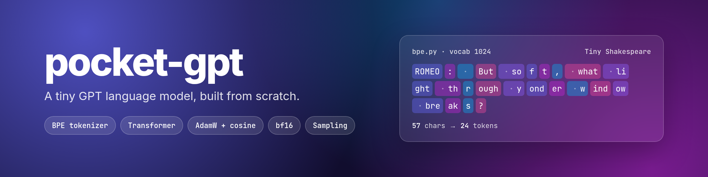

A GPT-style language model built from scratch: BPE tokenizer, transformer, training loop, and sampling, trained on a small corpus.

## Project structure
```text
pocket-gpt/
├── bpe.py               # Byte-level BPE from scratch: GPT-4 regex pre-split, merge training, encode/decode
├── data.py              # Download corpus, char/BPE tokenize -> data/<name>/, random-window batches
├── model.py             # Decoder-only transformer: causal attention, pre-norm blocks, tied head, generate()
├── train.py             # AdamW + warmup/cosine, grad clipping, bf16, eval (loss + bits/byte), checkpoint/resume
├── sample.py            # Generate text from a checkpoint with its own tokenizer
├── tests/
│   ├── test_model.py    # initial loss ≈ ln(vocab), no future-token leak, overfit one batch, generate shape
│   └── test_bpe.py      # first merge, unicode round-trip, compression, reload from merges
├── assets/banners/      # README banners (PNG) + their HTML sources
├── requirements.txt     # torch, numpy, regex, pytest
│
├── data/                # generated, git-ignored
│   ├── input.txt        #   raw Tiny Shakespeare (1.1 MB)
│   ├── char/            #   train.bin, val.bin (uint16 token ids), meta.json (vocab + byte counts)
│   └── bpe1024/         #   same layout; meta.json holds the learned merges
└── runs/                # generated, git-ignored
    └── <run>/ckpt.pt    #   model, optimizer, step, RNG, config, args (saved every eval)
```

**Data flow:** `input.txt` → `data.py` (tokenizer) → `train.bin`/`val.bin` → `train.py` (batches → `model.py` → cross-entropy → AdamW) → `ckpt.pt` → `sample.py` → text

## Quickstart
```bash
python -m venv .venv && .venv/bin/pip install -r requirements.txt
.venv/bin/python -m pytest -q tests      # sanity checks

# character-level
.venv/bin/python data.py                                         # -> data/char
.venv/bin/python train.py                                        # ~0.8M params, ~1 min on an RTX 5060
.venv/bin/python sample.py --prompt "ROMEO:" --temperature 0.8

# BPE
.venv/bin/python data.py --tokenizer bpe --vocab_size 1024       # -> data/bpe1024, learns merges in ~12s
.venv/bin/python train.py --data data/bpe1024 --out runs/bpe1024 --steps 1000
.venv/bin/python sample.py --ckpt runs/bpe1024/ckpt.pt --prompt "ROMEO:"
```
Every model field is a flag, e.g. `train.py --n_layer 6 --n_embd 256 --dropout 0.1 --out runs/bigger`.

A checkpoint (model, optimizer, step, RNG) is saved to `<out>/ckpt.pt` at every eval. If a run stops, continue it with
`train.py --out <same dir> --resume` (keep the same `--steps` so the LR schedule matches). Training refuses to overwrite an existing run without `--resume`.

## Results (default 0.8M model, RTX 5060)
Compare tokenizers by **val bits per byte (bpb)**, not loss: loss is per token, and tokens differ in size.

| Tokenizer | Bytes/token | Best val bpb | At step |
|-----------|-------------|--------------|---------|
| char (65) | 1.00 | 2.21 | ~4000 |
| BPE 1024 | 2.62 | 2.22 | ~1000, then overfits hard (383k train tokens) |

- Warmup + cosine + clipping vs constant LR: val loss 1.54 at ~3000 steps vs 1.56 at ~4250.
- bf16 vs fp32: ~1.20M vs ~0.73M tok/s, same loss.

## Next
Bigger corpus (TinyStories) so BPE stops overfitting → RoPE/RMSNorm/SwiGLU → KV cache → GPT-2 parity.
